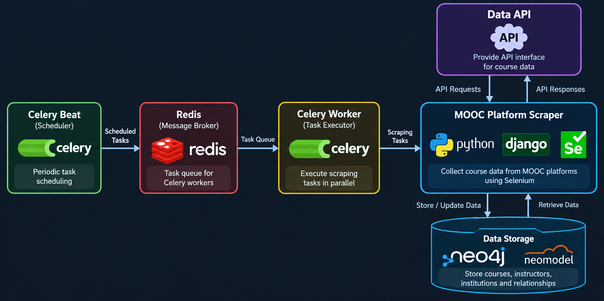
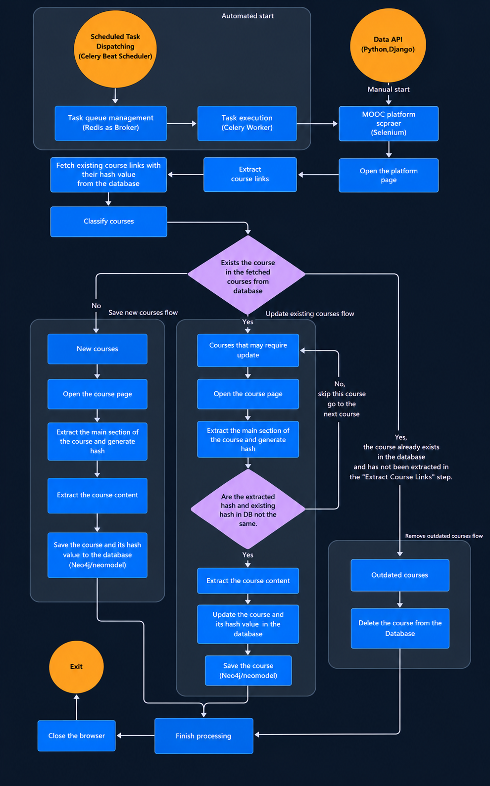
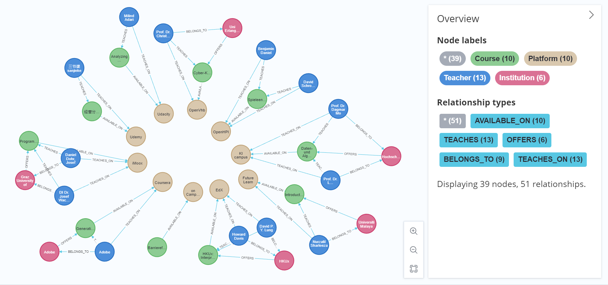

# MOOCentral V2 – Automated MOOC Data Collection and Management

**Bachelor's Thesis Project | University of Duisburg-Essen | 2025**

## Overview

MOOCentral V2 is an enhanced system for collecting, updating, and managing course data from multiple Massive Open Online Course (MOOC) platforms.

This project was developed as part of my Bachelor's thesis, *Improving Data Collection and Management in MOOCentral*. It builds upon an existing system and focuses on improving automation, scraping efficiency, data consistency, and periodic updates.

MOOCentral is part of the broader [CourseMapper project](https://coursemapper.de/landingPage), which focuses on supporting learners in discovering and navigating online courses.

## Key Features

- **Automated Web Scraping:** Extracting course information from multiple online learning platforms using Python and Selenium.
- **Periodic Updates:** Scheduling recurring scraping tasks to keep course information up to date.
- **Change Detection:** Using hashing techniques to identify modified course content and reduce unnecessary data collection and database updates.
- **Graph-Based Data Management:** Storing course information and relationships in a Neo4j graph database.
- **Background Processing:** Using Celery and Redis to schedule and execute scraping tasks.
- **Data Quality:** Identifying new courses, updating existing records, and removing outdated courses.

## Technology Stack

| Category | Technologies |
|---|---|
| Programming Language | Python |
| Backend Framework | Django |
| Web Scraping | Selenium |
| Graph Database | Neo4j |
| Object-Graph Mapping | Neomodel |
| Task Scheduling | Celery Beat |
| Background Processing | Celery |
| Message Broker | Redis |

## System Architecture

The system combines scheduled background tasks, web scraping, API functionality, and graph database storage.

The architecture illustrates how Celery Beat schedules recurring tasks, Redis manages the task queue, Celery Workers execute scraping tasks, and the scraper interacts with MOOC platforms and the Neo4j database.

## Process Workflow

The workflow illustrates the main course-processing steps, including course-link extraction, course classification, hash-based change detection, and database updates.

It covers three main cases:

- **New courses:** Extract course content and store new course records.
- **Existing courses:** Compare content hashes and update records when changes are detected.
- **Outdated courses:** Remove course records that are no longer available in the collected platform data.

## Knowledge Graph

MOOCentral V2 uses Neo4j to represent relationships between courses, teachers, platforms, and institutions.

The graph model connects course information with its associated platforms, instructors, and institutions. This allows related data to be represented and queried as a graph rather than as isolated records.

## Evaluation Results

The evaluation in my Bachelor's thesis compared MOOCentral V2 with its predecessor, MOOCentral V1.

- **57.8% average improvement in execution time** across the evaluated MOOC platforms.
- **100% completeness** on most evaluated platforms.
- **100% exactness** for extracted attributes in most cases.
- **Approximately 32.87% completeness for Udemy**, reflecting platform scale and execution constraints.

The evaluation focused on execution time, completeness, and exactness.

## Academic Information

- **Thesis:** *Improving Data Collection and Management in MOOCentral*
- **Degree:** Bachelor's thesis in Computer Science
- **Institution:** University of Duisburg-Essen
- **Year:** 2025

## Repository Note

This repository presents an overview of the project, its architecture, process workflow, graph data model, and evaluation results.

The original source code is maintained in a university-owned repository and is not included here.

## Author

**Mohamad Yazan Al Tabakh**
